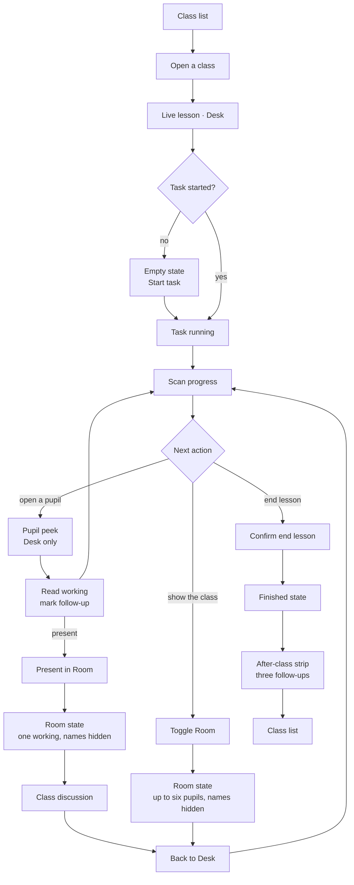
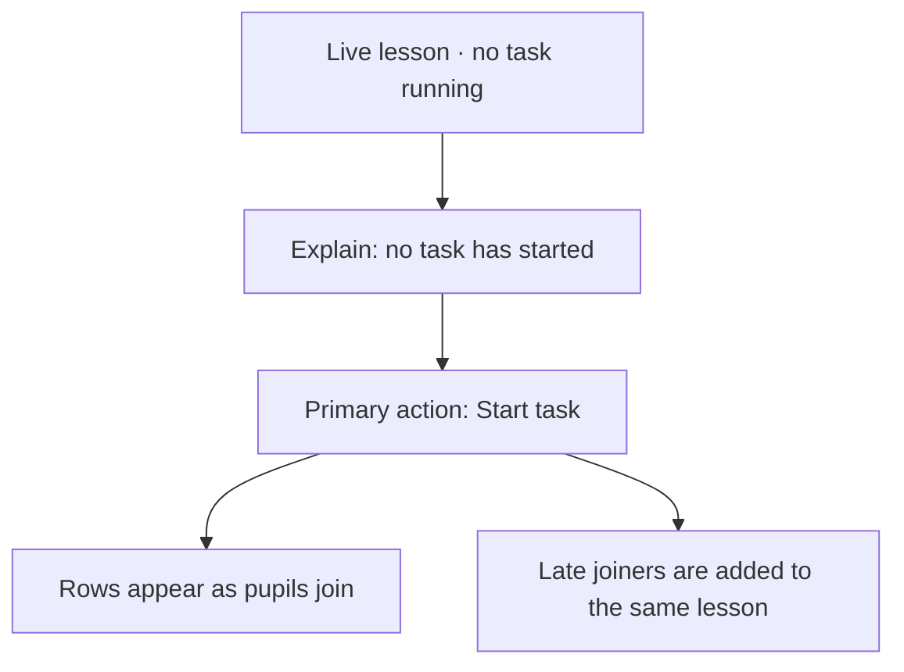
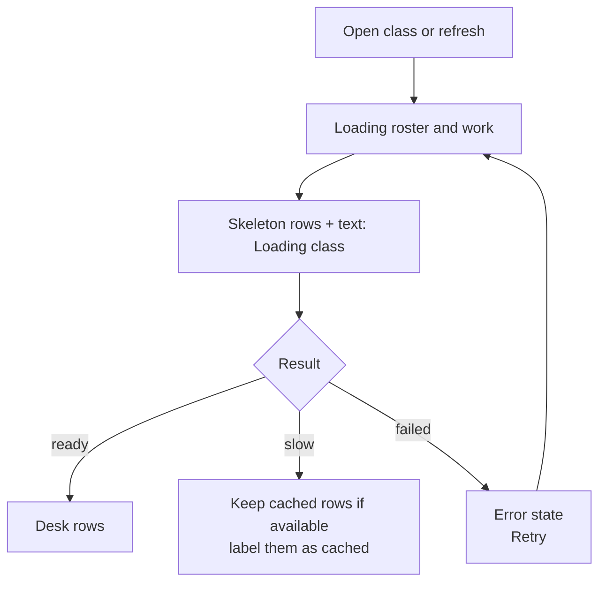
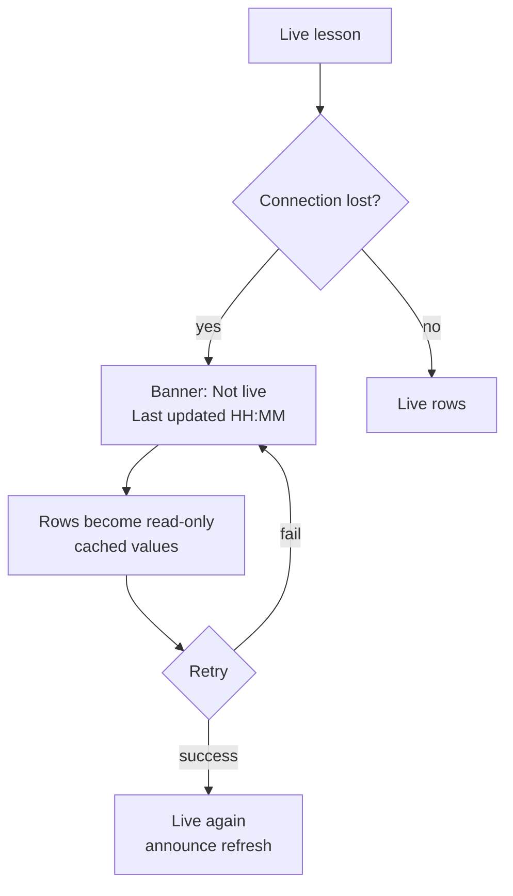
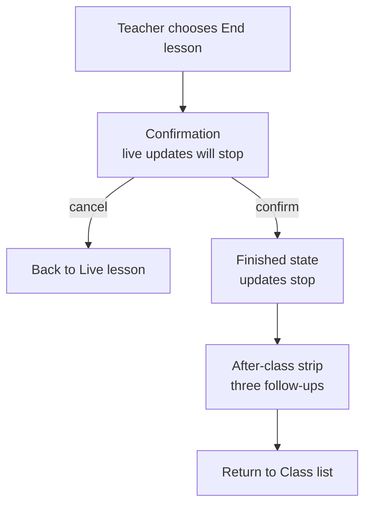

# Core flow and states

The teacher's core flow through a live lesson, plus the empty, loading, connection-lost and finished states. Each diagram is followed by the accessibility and privacy notes that belong beside it.

**Labels used:** `assumption`, `desk research`, `synthetic`, `self-review`. These are design intentions; nothing here has been tested.

**Scope:** one class (synthetic **Class North**, **Pupil 01–Pupil 12**), one 45-minute lesson, a 1280×800 laptop and a 1920×1080 projector. `synthetic`

---

## Core flow

**The short version:** open class → start task → scan → open a pupil (optionally presenting the working in Room) or toggle Room for a class overview → back to Desk → mark follow-ups → end lesson → after-class strip. `assumption`

### Accessibility notes beside the core flow

- The keyboard path is: Class list → `Enter` opens Live lesson → `Tab` reaches rows → arrow keys move row focus → `Enter` opens Pupil peek → `P` presents in Room, `R` toggles Room from Desk → `Esc` returns to Desk → `Tab` reaches **End lesson** → confirm → `Tab` reaches follow-ups. `assumption`
- Focus is visible at every step and returns to the originating row after Pupil peek closes. `assumption`
- Room is announced as a state change, not a page change; the lesson title and state remain in the page title. `assumption`
- Status is never colour alone: shape plus label plus, where useful, a last-updated time. `assumption`
- The primary action is reachable without a mouse, and no step traps focus. `assumption`
- Live updates use a polite announcement and are throttled; the screen does not read every row change aloud. `assumption`
- Reduced-motion preference removes transitions between Desk and Room; the change is instant. `assumption`
- 200% zoom must not hide **Start task**, **Present in Room** or **End lesson**. `assumption`

### Privacy notes beside the core flow

- Room hides names by default; the pupil is shown by seat code or initials. `assumption`
- Pupil peek is a private Desk view; presenting is an explicit action, not an automatic mirror. `assumption`
- The teacher can mark a follow-up without projecting the pupil's name or full work. `assumption`
- Room can show a class overview of up to about six pupils per page, or one working at a time; it never shows the full dense list. `assumption`
- No answer text is written to an event log; later event names carry synthetic identifiers only. `assumption`
- The teacher can return to a neutral holding screen at any pause. `assumption`

---

## Empty state

**When:** the class is open but no task is running, or the roster is present with no live work yet.

### What the teacher sees

- A short explanation that the lesson has not started, and the task that will run. `assumption`
- One primary action: **Start task**. `assumption`
- A secondary, low-emphasis way back to the Class list. `assumption`
- No fake rows, no invented pupils, no empty chart. `assumption`

### Accessibility notes

- The empty state is not an error; it uses plain language and does not announce an alert. `assumption`
- Focus starts on **Start task**; the heading explains the state before the button. `assumption`
- The button is a real button with a visible focus ring and a target of at least 44×44 px on Desk. `assumption`
- The state is conveyed in text, not by an empty area alone. `assumption`

### Privacy notes

- Room shows a neutral holding screen until the task starts; no names or work are visible. `assumption`
- A late joiner appears in the same lesson; the teacher does not need to expose the roster to the projector. `assumption`

---

## Loading state

**When:** the roster or the pupils' work is being fetched after opening a class, refreshing, or retrying.

### What the teacher sees

- A status line that says what is loading, in plain language. `assumption`
- Skeleton rows that match the final row shape, so the layout does not jump. `assumption`
- Cached rows, if any, clearly labelled as cached rather than live. `assumption`
- A retry action if loading fails, with a short explanation. `assumption`

### Accessibility notes

- The loading region uses a busy state and a text status, not a spinner alone. `assumption`
- Skeleton animation respects reduced motion; with reduced motion it is static. `assumption`
- The status is announced once, not repeatedly. `assumption`
- Focus is not moved unexpectedly while loading; when loading finishes, the heading or status receives a polite announcement. `assumption`
- The retry action is keyboard reachable and receives focus on failure. `assumption`

### Privacy notes

- Cached rows are labelled as cached; the teacher should not mistake old pupil data for live data. `assumption`
- Room stays on a neutral holding screen while loading; it does not show a partial roster. `assumption`
- No pupil work is included in the loading status text. `assumption`

---

## Connection-lost state

**When:** the live connection drops during a lesson.

### What the teacher sees

- A persistent banner that says the screen is **not live**, with the last-updated time. `assumption`
- Rows remain readable but are marked as cached; live-only actions are disabled with an explanation. `assumption`
- A retry action, and a short statement of what still works. `assumption`
- Room shows the same "not live" message in large type; it does not keep pretending to be live. `assumption`

### Accessibility notes

- The banner is announced once when the connection drops; it is not an alert that repeats. `assumption`
- The state is conveyed by text and icon shape, not red alone. `assumption`
- Retry is keyboard reachable; focus is not stolen from the current row. `assumption`
- When the connection returns, a single polite announcement says the screen is live again. `assumption`
- The banner does not cover the primary action or the current row. `assumption`

### Privacy notes

- Cached pupil data stays on the teacher's Desk; Room does not show a stale class list. `assumption`
- No new pupil data is invented while disconnected. `assumption`
- Whether a follow-up can be marked offline is an open question for this pass; if it can, it is queued locally and labelled as pending. `assumption`
- The last-updated time is a design aid, not a guarantee of data freshness. `assumption`

---

## Finished state

**When:** the teacher ends the lesson.

### What the teacher sees

- A confirmation that names what will stop and what will remain. `assumption`
- A finished state that clearly says the lesson has ended. `assumption`
- The after-class strip: up to three follow-ups marked during the lesson, each with enough context to act on. `assumption`
- A way back to the Class list. `assumption`

### Accessibility notes

- **End lesson** is a deliberate action with a confirmation; cancel returns focus to the button that opened it. `assumption`
- The finished state is announced as a state change, not as a new page. `assumption`
- Follow-ups are a list with headings, not a set of colour-coded chips. `assumption`
- The confirmation dialog traps focus only while open, has a visible close action, and can be dismissed with `Esc`. `assumption`
- The after-class strip is readable at 200% zoom without horizontal scrolling. `assumption`

### Privacy notes

- Ending the lesson clears Room to a neutral screen; no pupil names or work are left on the projector. `assumption`
- The after-class strip is teacher-facing; it does not rank pupils or show a public leaderboard. `assumption`
- Follow-ups should carry the minimum context needed; the full pupil work is not copied into the strip by default. `assumption`
- Retention and export are out of scope for this pass and remain open design questions. `assumption`

---

## State summary

| State | Primary action | What Room shows | Main accessibility note | Main privacy note | Label |
|---|---|---|---|---|---|
| Empty | Start task | Neutral holding screen | Heading explains the state before the button | No names or work before the task starts | `assumption` |
| Loading | Wait, or retry on failure | Neutral holding screen | Text status and busy state, not a spinner alone | Cached rows labelled as cached | `assumption` |
| Live · Desk | Scan, open a pupil, present, end | Not applicable | Keyboard row focus, visible focus | Private names stay on Desk | `assumption` |
| Live · Room | Discuss, return to Desk | One working, or up to six pupils per page, in large type | State change announced; Esc returns | Names hidden by default | `assumption` |
| Connection lost | Retry | "Not live" in large type | Announced once; text plus shape | No stale class list on the projector | `assumption` |
| Finished | Review follow-ups, return to Class list | Neutral screen | Confirmation, focus return, list semantics | No ranking; minimum context | `assumption` |

---

## Cross-flow accessibility checklist (design targets)

- [ ] Every interactive element is reachable by keyboard, in a predictable order. `assumption`
- [ ] Focus is visible and never lost after a state change or dialog close. `assumption`
- [ ] Status uses shape and label, not colour alone. `assumption`
- [ ] Room body text is at least 28 px and targets are at least 64 px, as a design target. `assumption`
- [ ] Room shows at most about six pupils before paging, as a design target. `assumption`
- [ ] Live updates use polite, throttled announcements. `assumption`
- [ ] Reduced motion is respected for every transition and skeleton. `assumption`
- [ ] 200% zoom does not hide the primary action. `assumption`
- [ ] Contrast is checked later against WCAG 2.2 AA as a design target, not claimed now. `assumption`
- [ ] No time limit discards the teacher's work. `assumption`

## Cross-flow privacy checklist (design notes)

- [ ] Room hides names by default and uses a seat code or initials. `assumption`
- [ ] Presenting is explicit; there is no automatic mirroring. `assumption`
- [ ] A neutral holding screen covers pauses, loading and the finished state. `assumption`
- [ ] No answer text is stored in events; only event names and synthetic identifiers. `assumption`
- [ ] No third-party trackers in a later demo. `assumption`
- [ ] The teacher can switch Room to the neutral holding screen before stepping away. `assumption`
- [ ] Retention, export and consent are open questions, not claims. `self-review`

---

## What this document does not decide

| Open question | Why it is open | Label |
|---|---|---|
| Can a follow-up be marked while disconnected? | Needs a decision on local queueing and conflict handling. | `assumption` |
| Does Room survive a reload? | Safe default is Desk; not tested. | `assumption` |
| How many rows before paging in Room? | The brief suggests about six; not tested. | `assumption` |
| Is the after-class strip editable? | Depends on how teachers use follow-ups. | `assumption` |
| What is the idle threshold? | The journey uses about four minutes as a placeholder. | `assumption` |
| What is retained after the lesson? | A privacy question for a later pass, not a legal conclusion. | `self-review` |
