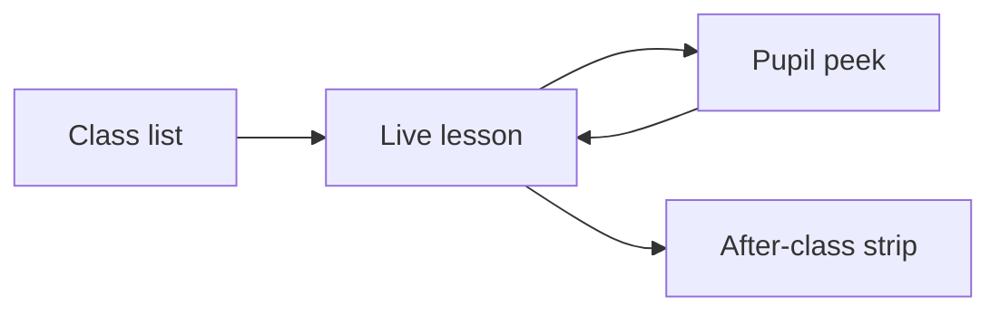
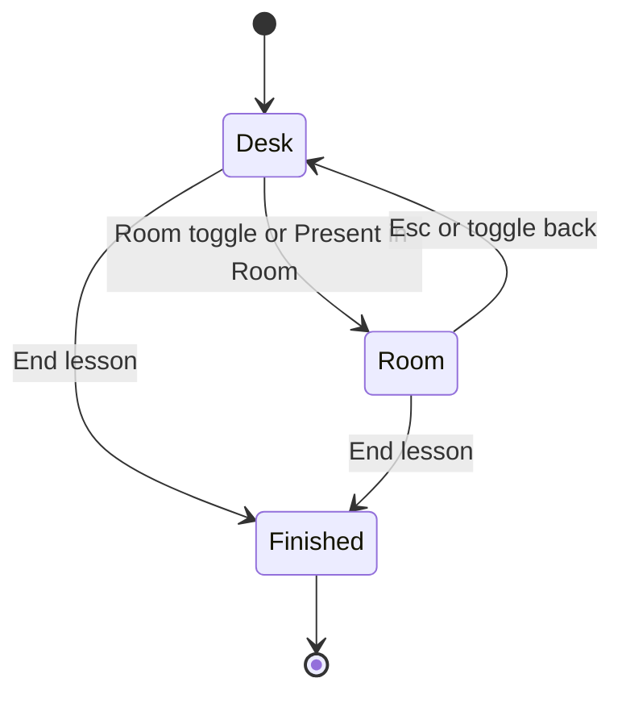

# Sitemap

The screen structure for the teacher's live-lesson board. It is deliberately small: four surfaces, plus one state of the Live lesson screen.

**Labels used:** `assumption`, `desk research`, `synthetic`, `self-review`. Structural claims are design intentions, not validated navigation.

---

## The structure

**Read the diagram as:** Class list → Live lesson → Pupil peek → After-class strip. Pupil peek returns to Live lesson; the after-class strip is reached when the lesson ends. `assumption`

---

## Room is a state of Live lesson

**Room is not a separate product, screen or navigation entry.** It is a presentation state of the **Live lesson** screen: the same lesson, the same data, a larger and anonymised view for the projector. Desk is the laptop state. The teacher toggles between them without leaving the lesson. `assumption`

Both `Desk` and `Room` above belong to the **same Live lesson screen**. `Finished` is the state that carries the after-class strip. `assumption`

---

## Surfaces

| Surface | Type | Purpose | Entry and exit | Label |
|---|---|---|---|---|
| **Class list** | Screen | Choose a class and open its Live lesson. | Entry point; exits to Live lesson. | `assumption` |
| **Live lesson** | Screen with two states | Run the lesson: start the task, scan progress, mark follow-ups, end the lesson. | From Class list; exits to Class list, Pupil peek or After-class strip. | `assumption` |
| **Live lesson · Desk state** | State | Dense laptop view: rows, status, working preview, private names. | Default state of Live lesson. | `assumption` |
| **Live lesson · Room state** | State | Projector view: large type, up to about six pupils per page or one working at a time, names hidden by default. | Toggled from Desk or entered by **Present in Room**; returns with Esc or the toggle. | `assumption` |
| **Pupil peek** | Panel within Live lesson | One pupil's working and the actions for that pupil. | Opened from a row on Desk; returns to the same row. | `assumption` |
| **After-class strip** | End state of Live lesson | A short list of follow-ups marked during the lesson. | Reached after **End lesson**; exits to Class list. | `assumption` |

---

## Navigation rules

| Rule | Reason | Label |
|---|---|---|
| Room is reached only from inside Live lesson, by the Room toggle or by **Present in Room**. | It is a state, not a destination; a separate entry would imply a second product. | `assumption` |
| `Esc` leaves Room and returns to Desk. | A predictable, keyboard-friendly way back from the projector view. | `assumption` |
| Pupil peek opens from a row and returns focus to that row. | The teacher should not lose their place in the class. | `assumption` |
| Presenting in Room is an explicit action from Pupil peek. | The projector should never mirror private pupil data automatically. | `assumption` |
| The after-class strip is available only after the lesson ends. | Follow-ups belong to the end of the lesson, not to a separate product. | `assumption` |
| There is no separate Room route, pupil app, settings area or analytics dashboard in this pass. | Keeps the structure on the brief and avoids inventing scope. | `self-review` |

---

## Accessibility notes for the structure

These are design targets to check later, not compliance claims. `self-review`

- Every screen has one clear page title and one main landmark; the current class and lesson state are named in text. `assumption`
- The keyboard order follows the visual order: Class list → rows → Pupil peek → Room toggle → End lesson → after-class strip. `assumption`
- Room is announced as a state change, not as a new page. `assumption`
- Focus is always visible; closing Pupil peek returns focus to the row that opened it. `assumption`
- No state relies on colour alone; status uses shape and label. `assumption`
- The structure must survive 200% zoom without hiding the primary action. `assumption`

## Privacy notes for the structure

These are design notes, not legal or compliance claims. `self-review`

- Room hides pupil names by default and uses a seat code or initials. `assumption`
- Pupil peek is a Desk-only, teacher-private view; presenting sends an anonymised view to Room. `assumption`
- The projector shows a neutral holding screen when the lesson is paused, loading or finished. `assumption`
- No answer text is stored in the event log; the structure assumes event names and synthetic identifiers only. `assumption`
- The teacher controls what is projected; there is no automatic mirroring of the laptop. `assumption`

---

## What is deliberately not in the sitemap

| Not included | Why | Label |
|---|---|---|
| A separate Room product or route | Room is a state of Live lesson. | `self-review` |
| Accounts, sign-in or pupil-facing app | Out of scope for this design-process pass. | `self-review` |
| Settings, admin or class-import screens | Not needed to test the core flow. | `self-review` |
| Analytics or post-lesson dashboard | The after-class strip is the thin end state, not a product. | `self-review` |
| A task-authoring flow | The lesson assumes a task already exists. | `assumption` |

---

## Open structural questions

1. Should Pupil peek be a panel or a full route? This pass treats it as a panel so the class context stays visible. `assumption`
2. Should the after-class strip be editable after the lesson ends? Undecided. `assumption`
3. Should a late joiner be visible on the Class list before the lesson starts? Undecided. `assumption`
4. Should the Room state survive a page reload, or always return to Desk? Undecided; safe default is Desk. `assumption`
