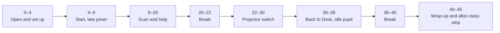

# One 45-minute lesson journey

A constructed walkthrough of a single maths lesson on the live-lesson board. It exists to test the flow on paper, not to describe a real lesson.

**Scenario status:** `synthetic`. Nothing here was observed, timed or reported by a teacher. The class, pupils and events are invented for design purposes.

**Synthetic context:** Class North, 12 pupils (Pupil 01–Pupil 12), pupils on their own devices, a 1280×800 laptop on the teacher's desk and a 1920×1080 projector at the front. `synthetic`

**Labels used:** `assumption`, `desk research`, `synthetic`, `self-review`. Each row carries one.

---

## The journey at a glance

The sequence above is `synthetic`. The two breaks are deliberate pauses in the lesson, not idle time in the product. `assumption`

---

## Minute-by-minute

| Time | Phase | What happens in the synthetic lesson | Desk (laptop) | Room (projector state) | Label |
|---:|---|---|---|---|---|
| 0–2 | Before pupils arrive | The teacher opens **Class North** from the Class list. The roster loads. No task has started. | Empty state with the task summary and **Start task** as the primary action. | Projector is on but shows a neutral holding screen. No pupil data. | `synthetic` |
| 2–4 | Check the task | The teacher checks that the intended task is selected and that the projector is connected. | Task summary and start action remain visible; focus starts on **Start task**. | Neutral holding screen remains. | `synthetic` |
| 4–7 | Pupils arrive | Ten of the twelve pupils join. The teacher starts the task rather than waiting for everyone. | Rows appear as pupils join. Missing pupils are shown as "not joined", without a countdown or alarm. | Still neutral; the teacher has not switched to Room. | `synthetic` |
| 7–9 | Late joiner | **Pupil 12** joins at about minute 8. | A new row appears in the same lesson. No restart, no modal, no duplicate lesson. The row moves to "working" after the first step. | Unchanged. | `synthetic` |
| 9–20 | Independent work | The teacher scans, sorts by "needs help" and visits **Pupil 04**. | Status by shape and label, last-updated time, keyboard row focus, a short view of the working. | Off or neutral; the teacher is not projecting pupil data. | `synthetic` |
| 20–22 | **Break** | The teacher pauses the whole-class screen and moves around the room. Pupils put devices down for a moment. | Live lesson stays open; the teacher can switch Room to the neutral holding screen before stepping away. | Neutral holding screen. No names, no live rows. | `synthetic` |
| 22–24 | Choose a discussion | The teacher notices **Pupil 07** has two different approaches worth discussing. | Opens **Pupil peek** from the row, reads the working, chooses **Present in Room**. | Still neutral until the teacher confirms the switch. | `synthetic` |
| 24–30 | **Projector switch** | The teacher switches to Room. One pupil's working is shown with the seat code **N-07**, not a name. The class discusses the two approaches. | Desk keeps the private view: the same working plus the pupil's name and the row context. | Large type, one working at a time, no names, no full class list. A visible label says **Room**. | `synthetic` |
| 30–31 | Back to Desk | The teacher returns to Desk and marks a follow-up for Pupil 07. | Follow-up is marked; a short confirmation is announced. Focus returns to the pupil's row. | Returns to the neutral holding screen. | `synthetic` |
| 31–38 | Independent work, idle pupil | The teacher scans again. **Pupil 09** has not changed their working for about four minutes. The teacher opens the last step and checks in quietly. | "Idle" is shown with a shape, a label and a time — not colour alone. No public call-out. The teacher marks two more follow-ups. | Off or neutral. The idle signal is not projected. | `synthetic` |
| 38–40 | **Break** | The teacher pauses for a reset before the wrap-up. | Lesson stays open; the teacher can switch Room to the neutral holding screen and step away without leaving pupil data on the projector. | Neutral holding screen. | `synthetic` |
| 40–44 | Wrap-up | The teacher discusses one more example, then ends the lesson. | **End lesson** requires a confirmation. Live updates stop. The teacher can review the follow-ups. | Cleared to a neutral screen; no pupil data left visible. | `synthetic` |
| 44–45 | After-class strip | The teacher sees the three follow-ups marked during the lesson. | Finished state with the after-class strip: three follow-ups, no ranking of pupils. | Off, or a neutral screen. | `synthetic` |

---

## What this journey is testing

| Design question | Where it appears | Why it matters | Label |
|---|---|---|---|
| Can the lesson start before the full class arrives? | 4–9 | Late joiners are normal; a restart would cost lesson time. | `assumption` |
| Does a late joiner appear without a duplicate lesson? | 7–9 | The roster and the task must stay in one lesson. | `assumption` |
| Can the teacher scan and choose the next pupil quickly? | 9–20, 31–38 | The core value is choosing the next intervention. | `assumption` |
| Does the projector switch hide names by default? | 24–30 | The class must be able to discuss the mathematics without identifying the pupil. | `assumption` |
| Is the teacher's private view preserved on Desk? | 24–30 | The teacher still needs the name and context to act. | `assumption` |
| Can an idle pupil be noticed without a public alarm? | 31–38 | "Idle" is ambiguous and can be sensitive. | `assumption` |
| Are the breaks safe for the projector? | 20–22, 38–40 | A paused lesson should not leave pupil data on the wall. | `assumption` |
| Does the lesson end with a short, usable list? | 44–45 | Follow-ups are the bridge to the next lesson. | `assumption` |

---

## What this journey does not claim

- It is not an observed lesson, an interview or a usability session. `self-review`
- The times are a design scaffold, not measured durations. `self-review`
- The "about four minutes" idle threshold is a placeholder to discuss, not a validated rule. `assumption`
- The three follow-ups are a design limit from the brief, not a finding about how many teachers need. `assumption`
- No pupil names, schools, classes or real people are represented. `self-review`

---

## Open questions raised by the journey

1. Should a late joiner inherit the task from minute zero, or start from the current point? `assumption`
2. What should Room show during a break: a neutral holding screen, a lesson title, or nothing? `assumption`
3. Can the teacher mark a follow-up while the connection is lost? This pass does not decide. `assumption`
4. Should the after-class strip be editable after the lesson ends? `assumption`
5. How does an occasional teacher know which class to open if the handover is incomplete? `assumption`
